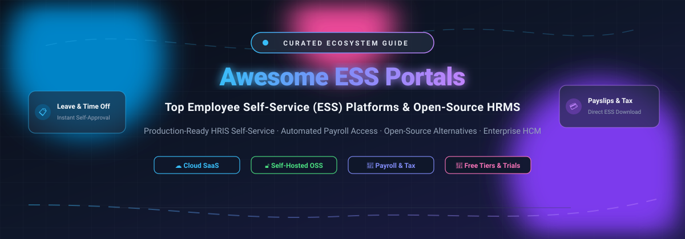

# 🌟 Awesome-Employee-Self-Service-Ess-Portal

  

  

    <strong>A curated directory of top-tier SaaS platforms and self-hosted open-source GitHub projects for Employee Self-Service (ESS) Portals, HRIS, and modern workforce management.</strong>
  

  

    
    
    
    
    
    
  

---

## 📌 Top Employee Self-Service (ESS) Portal Ecosystem

> **Curated List of SaaS Platforms & Open-Source GitHub Projects**  
> *Focused on HRIS Self-Service, Payroll Access, Time-Off Management & Employee Document Repositories*  
> **Last updated: March 2026**

This repository tracks notable **SaaS platforms** and **open-source projects** for **Employee Self-Service (ESS) Portals**. These solutions empower employees with direct, self-guided access to essential HR data—payslips, tax withholding forms, leave applications, personal records, and company policy documents—drastically reducing administrative overhead on HR and People Operations teams while improving data accuracy, privacy, and employee autonomy.

Whether you are evaluating scalable multi-tenant cloud SaaS or self-hosting open-source HRMS software to maintain complete data sovereignty, this guide provides side-by-side transparency into capabilities, company scale, starting tier pricing, and free tier allowances.

---

## 📑 Table of Contents
- [📊 Sector Overview & Market Dynamics](#-sector-overview--market-dynamics)
- [☁️ SaaS/Hosted Platforms](#️-saashosted-platforms)
- [🔓 Open-Source GitHub Projects](#-open-source-github-projects)
- [🤝 How to Contribute](#-how-to-contribute)
- [💖 Support](#-support)
- [📈 Star History](#-star-history)
- [⚠️ Disclaimer](#️-disclaimer)

---

## 📊 Sector Overview & Market Dynamics

The global Employee Self-Service (ESS) portal software market is estimated at **$7.0B to $9.8B** (projected to exceed $22B+ by the early 2030s at an ~8.7% CAGR). The market structure is bifurcated: **moderately concentrated** at the enterprise tier dominated by comprehensive HCM suites (like Workday and ADP), yet **highly fragmented** in the SMB/mid-market where dozens of specialized SaaS and self-hosted open-source providers compete with modular, agile tools.

---

## ☁️ SaaS/Hosted Platforms

| Product | Scale (Revenue / Valuation) | Description | Pricing (Starting) | Free Tier / Trial Limits |
|:---|:---|:---|:---|:---|
| **[ADP Workforce Now](https://www.adp.com/)** | ~$22.0B Rev / ~$121B MCap | 🏢 Enterprise HCM with ESS for pay, benefits, and time. Base fee ~$160/month + ~$4/employee/month (buyer-reported). | ~$160/month base + ~$4/employee/month | 🚫 No free forever plan; 3-month free promotional payroll trial on select small business plans or interactive guided product demo |
| **[Workday HCM](https://www.workday.com/)** | ~$10.0B Rev / ~$46B MCap | 🌐 Enterprise HCM with comprehensive ESS, talent, and workforce management. | ~$120 to $185 PEPM (typical core HCM contract baseline; ~$300K/year minimum spend) | 🚫 No free forever plan; no self-serve free trial; guided enterprise demo via sales |
| **[Paychex Flex](https://www.paychex.com/)** | ~$6.5B Rev / ~$41B MCap | 💼 SMB & mid-market payroll and HR with ESS. | $39/month base + $5/employee/month (Essentials plan) | 🚫 No free forever plan; no public free trial; customized demo via sales |
| **[TriNet (Zenefits)](https://www.zenefits.com/)** | ~$4.9B Rev / ~$3.1B MCap | 👥 SMB HR platform (acquired by TriNet) with employee self-service portal, payroll, and benefits. | $8.00/employee/month (minimum 5 employees) | 🚫 No free forever plan; no public self-serve free trial; interactive demo via sales |
| **[Paylocity](https://www.paylocity.com/)** | ~$1.8B Rev / ~$8.5B MCap | 📈 Mid-market HCM with ESS, payroll, and workforce analytics. | ~$15 to $22 PEPM (starting core payroll/HR baseline) | 🚫 No free forever plan; no self-serve free trial; live walkthrough demo via sales |
| **[Zoho People](https://www.zoho.com/people/)** | ~$1.4B+ Rev / ~$12B Est. Val | 🛠️ Cloud HRIS with employee self-service (web + mobile), leave management, and attendance. | ₹105/employee/month (~$1.25/employee/month, billed annually) | 🎁 **Free forever plan**: up to 5 employees; **30-day free trial** with full feature access (no credit card required) |
| **[Rippling](https://www.rippling.com/)** | ~$1.0B ARR / ~$16.8B Val | ⚡ Unified workforce platform combining HR, ESS, IT, and finance. | $8.00/user/month (plus custom modular platform fee) | 🚫 No free forever plan; 6-month free trial for eligible VC-backed startups via Startup Program (standard accounts require sales demo) |
| **[Gusto](https://gusto.com/)** | ~$1.0B ARR / ~$9.3B Val | 💵 Payroll-first HR with employee self-service for pay stubs, W-2s, and benefits. | $40/month base + $6/employee/month (Simple plan; or $35/month + $6/contractor) | 🚫 No free forever plan; no open self-serve free trial (occasional 30-day promotional waiver via partner links; interactive demo available) |
| **[Personio](https://www.personio.com/)** | ~$300M+ ARR / ~$8.5B Val | 🇪🇺 European all-in-one HR software with ESS for SMBs. | €5.00 to €7.60 PEPM (Core package baseline) | 🚫 No free forever plan; **14-day free trial** with full test environment (no credit card required) |
| **[BambooHR](https://www.bamboohr.com/)** | ~$300M+ ARR / ~$1.9B Val | 🎋 SMB-focused HRIS with self-service portal, time-off tracking, and onboarding. | $10.00/employee/month (Core plan baseline) | 🚫 No free forever plan; **7-day free trial** with full self-serve access (no credit card required) |

---

## 🔓 Open-Source GitHub Projects

> Sorted by GitHub_Stars in descending order.

| Project | Stars_Badge | Tech Stack | Description |
|:---|:---|:---|:---|
| **[Frappe HR](https://github.com/frappe/hrms)** |  | Python, Vue.js, JavaScript | 🚀 **The premier standalone open-source HRMS & Payroll solution with built-in ESS.** Features self-service for leave requests, expense reimbursements, payslip access, shift scheduling, and a mobile check-in app. Integrated directly with ERPNext. |
| **[Horilla HRMS](https://github.com/horilla/horilla-hr)** |  | Python (Django), HTMX, JavaScript | 🎯 **Comprehensive Django-based open-source HRMS with employee self-service.** Includes ESS modules for profile management, time-off applications, attendance tracking, onboarding, recruitment, and asset management. |
| **[OrangeHRM](https://github.com/orangehrm/orangehrm)** |  | PHP, MySQL, Symfony | 🏛️ **Battle-tested open-source HR platform.** Offers extensive employee and manager self-service portals, personnel records, leave management, timesheets, and disciplinary record tracking. |
| **[TimeOff.Management](https://github.com/timeoff-management/timeoff-management-application)** |  | Node.js, Express, JavaScript | 📅 **Dedicated self-service leave and absence management portal.** Lightweight, user-friendly tool allowing staff to request vacations, view team absence calendars, and manage approvals. |
| **[IceHrm](https://github.com/gamonoid/icehrm)** |  | PHP, MySQL, JavaScript | 🧊 **Modular open-source HRIS with employee self-service.** Empowers staff to track daily attendance, apply for time off, download corporate policies, and claim expenses via a single-page dashboard. |
| **[Jorani](https://github.com/jorani/jorani)** |  | PHP, MySQL | ⏱️ **Open-source leave and overtime management system.** Provides multi-level approval workflows, calendar synchronization, REST APIs, and LDAP/SAML SSO support. |
| **[Headcount](https://github.com/bluewave-labs/Headcount)** |  | Node.js, React, MUI | 👥 **Modern workspace HR & employee directory.** Provides employee self-service profiles, directory search, time-off logging, and team org charts. |
| **[Euron Open HRMS](https://github.com/euron-sde-team/euron-open-hrms)** |  | Python, Docker, Terraform | 🔐 **Multi-tenant enterprise open-source HRMS with secure ESS.** Docker Compose and AWS deployment. Highlights PII encryption (AES-256-GCM), QR-verified payslips, onboarding links, and 24-country payroll rule packs. |
| **[Sentrifugo](https://github.com/sentrifugo/sentrifugo)** |  | PHP (Zend), MySQL | 📦 **Classic modular open-source HRMS.** Features configurable employee self-service dashboards, performance appraisals, background checks, and leave management. |

---

## 🤝 How to Contribute

Contributions, suggestions, and corrections are warmly welcomed! 🌟

1. 🍴 **Fork** this repository.
2. 🌿 Create a descriptive feature branch (`git checkout -b feature/add-new-portal`).
3. 📝 Update `README.md` following the existing format (include product/repo name, official link, Stars_Badge, accurate starting pricing, or self-hosted requirements).
4. 💾 Commit your changes (`git commit -m 'Add New-Tool to ESS directory'`).
5. 🚀 Push to your branch (`git push origin feature/add-new-portal`).
6. 📬 Submit a **Pull Request** detailing why the tool is a valuable addition to the ecosystem.

---

## 💖 Support

Thank you for exploring and utilizing the **Awesome Employee Self-Service (ESS) Portal** directory! 🙏

If you find this repository valuable:
- ⭐ **Star this repository** to help others discover it!
- 🍴 **Fork and share** it with your HR tech peers, people operations specialists, and developers.
- ☕ Consider buying a coffee or sponsoring the project to support ongoing maintenance:
  - 👉 **[Sponsor Dashboard on GitHub](https://github.com/sponsors/ishandutta2007)**

---

## 📈 Star History

---

## ⚠️ Disclaimer

- This is a **community-curated informational directory** — inclusion does not constitute a commercial endorsement.
- ESS portals handle sensitive employee Personally Identifiable Information (PII) including bank accounts, social security/tax IDs, home addresses, and compensation history. Always ensure end-to-end encryption at rest and in transit, strict Role-Based Access Control (RBAC), multi-factor authentication (MFA/TOTP), and local statutory compliance (GDPR, HIPAA, SOC 2, CCPA).
- **Pricing varies dynamically**: SaaS vendors frequently adjust contract tiers, implementation minimums, and volume discounts. Always confirm final per-employee-per-month (PEPM) rates and contractual escalators directly with vendors before procurement.

---

  Made with ❤️ for HR administrators, People Ops leaders, and software engineers building employee-friendly workplaces.

